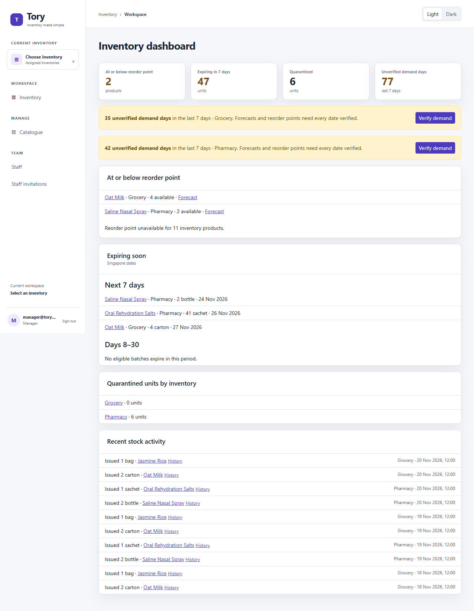
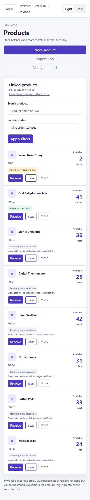
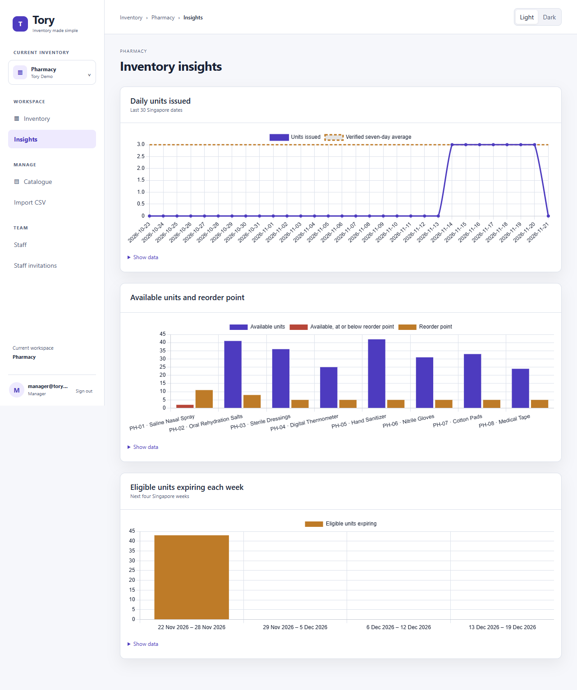
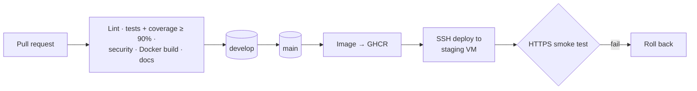

# Tory — Inventory Management & Demand Forecasting System

[](https://github.com/Mike-Franco/ay2627s2-cicdp-MikeAbat/actions/workflows/django-ci.yml?query=branch%3Adevelop)
[](https://github.com/Mike-Franco/ay2627s2-cicdp-MikeAbat/actions/workflows/security.yml?query=branch%3Adevelop)
[](https://github.com/Mike-Franco/ay2627s2-cicdp-MikeAbat/actions/workflows/docker-ci.yml?query=branch%3Adevelop)
[](https://github.com/Mike-Franco/ay2627s2-cicdp-MikeAbat/actions/workflows/docs-ci.yml?query=branch%3Adevelop)


**Batch-accurate stock control with explainable, Manager-verified demand forecasts for small businesses.**

Tory is a Singapore Polytechnic ST0529 CA1 project. It tracks stock by batch and expiry, protects every movement with PostgreSQL-enforced audit rules, and turns verified daily demand into reorder points that a Manager can check line by line.

## Features

- **Accounts and access:** email sign-in with throttling and session expiry, plus Manager and Staff roles with business and inventory boundaries. Staff join by invitation; password reset and Staff deactivation are built in.
- **Inventories and catalogue:** Managers create and rename inventories. A shared product catalogue has per-product base units, an expiry policy and reorder settings, and products can be deactivated and reactivated.
- **Batch stock:** receiving records expiry dates, and stock is issued first-expiry-first-out (FEFO). Managers can enter absolute counts. Expired stock is quarantined automatically, then disposed of with a recorded reason. Every movement writes an immutable audit event.
- **CSV import and export:** atomic stock CSV import with duplicate protection, and CSV export of current stock and history.
- **Demand and reorder:** seven-day verified demand per product, with bulk verification for whole inventories. Reorder points and suggested order quantities show their working.
- **Dashboard and insights:** stat tiles, low-stock and expiring lists, and recent activity. Each inventory also has demand, stock-vs-reorder and expiry charts, with data tables behind each chart.
- **Mobile layout:** product cards on phones, plus styled 404/403/500 pages.

## Screenshots

| Dashboard | Products on a phone | Insights |
| --- | --- | --- |
|  |  |  |

Screenshots use the `seed_demo` data. Replace the files in `docs/screenshots/` to update them.

## Quick start

With Docker Desktop (or Docker Engine with the Compose plugin):

```text
docker compose up --build
docker compose exec web python manage.py seed_demo
```

Open <http://localhost:8000/login/> and sign in with the demo Manager or Staff email. `seed_demo` prints any generated password. Set `DEMO_MANAGER_PASSWORD` and `DEMO_STAFF_PASSWORD` first to choose your own. A fresh demo has two weeks of varied sample demand, so Forecast accuracy shows a realistic error. Two dates on Reusable Grocery Bag await Manager verification, so the Grocery dashboard has a review task while Oat Milk has a numeric forecast and suggested order. Re-running the command fills blank product settings and keeps the existing stock and demand records.

Run the full test suite in the container:

```text
docker compose run --rm -e DJANGO_ENV=test -e DJANGO_MIGRATE_ON_START=false web python manage.py test --noinput
```

Without Docker, see [local development](CHANGELOG.md#local-django-smoke-checks). PostgreSQL with `track_commit_timestamp=on` is required; there is no SQLite fallback.

## How it is built and shipped



- **[CI/CD pipeline](docs/design/CICD_PIPELINE.md):** every gate and what it blocks on.
- **[Deployment view](docs/design/DEPLOYMENT.md):** Caddy, gunicorn/Django and PostgreSQL on one VM.
- **[Component view](docs/design/COMPONENTS.md):** apps, services, templates and database triggers.

## Continuous deployment

Staging runs on a single VM with docker compose: PostgreSQL with `track_commit_timestamp=on`, the Tory image, and Caddy for automatic HTTPS ([ADR-005](docs/decisions/ADR-005-staging-vm-hosting.md)). Managed PostgreSQL services cannot set that parameter.

| Workflow | Trigger | What it does |
| --- | --- | --- |
| [CD](.github/workflows/cd.yml) | Django PostgreSQL CI passes for a push to `main`, or run by hand | Waits for every other check on the commit, pushes `ghcr.io/<repo>:sha-<commit>` and `:latest`, deploys over SSH to the `staging` environment, then smoke-tests `/healthz` and `/login/` over HTTPS. A failure rolls back to the previous image and leaves the run red. |
| [Release](.github/workflows/release.yml) | Push a `v*` tag on a deployed commit | Creates a GitHub Release with generated notes and tags that commit's image with the version. |
| [Staging scheduled jobs monitor](.github/workflows/scheduled-ops.yml) | Hourly, or run by hand | Fails if the VM's five-minute `process_expiry_quarantine` and `finalize_commit_times` cron jobs have not succeeded in 15 minutes. |

Set up the VM and the `staging` environment secrets (`VM_HOST`, `VM_USER`, `VM_SSH_KEY`, `VM_SSH_KNOWN_HOSTS`, `DJANGO_SECRET_KEY`, `POSTGRES_PASSWORD`) and the `TORY_DOMAIN` variable with the [staging VM runbook](docs/deployment/STAGING_VM.md). Until those are configured, the deploy job fails with a message naming the missing value.

## Tech stack

| Layer | Choice |
| --- | --- |
| Application | Python 3.13, Django 5.2 LTS, gunicorn, WhiteNoise |
| Database | PostgreSQL 18 with `track_commit_timestamp=on`, triggers for stock and audit invariants |
| Front end | Django templates, Bootstrap 5, Chart.js for Insights |
| Packaging | Multi-stage Docker image (non-root), docker compose |
| CI/CD | GitHub Actions: ruff, coverage, pip-audit, CodeQL, gitleaks, Docker and Mermaid checks; GHCR; SSH deploy |
| Planning | Jira (TORY project), Agile Kanban with sprint-style cycles |

## Documentation

- **Architecture:** [overview and Django evidence](docs/design/ARCHITECTURE.md), [ERD](docs/design/ERD.md), [UI design](docs/design/DESIGN.md).
- **Decisions:**
  - [ADR-001 backend and database](docs/decisions/ADR-001-backend-and-database.md);
  - [ADR-002 Agile Kanban delivery](docs/decisions/ADR-002-agile-kanban-delivery.md);
  - [ADR-003 front-end architecture](docs/decisions/ADR-003-frontend-architecture.md);
  - [ADR-004 demo seed backdating](docs/decisions/ADR-004-demo-seed-backdating.md);
  - the other [decision records](docs/decisions/).
- **Requirements:** the [SRS](docs/requirements/SOFTWARE_REQUIREMENTS_SPECIFICATION.md), [traceability matrix](docs/requirements/REQUIREMENTS_TRACEABILITY_MATRIX.md), [role permissions](docs/requirements/ROLE_PERMISSION_MATRIX.md) and [gap analysis](docs/requirements/).
- **Planning:** [schedule](docs/planning/PROJECT_SCHEDULE.md) and [iteration log](docs/planning/AGILE_ITERATION_LOG.md).
- **Performance and operations:**
  - [TORY-26 validation](docs/decisions/TORY-26-integrated-validation.md);
  - [TORY-46 login throttle benchmark](docs/decisions/TORY-46-login-throttle-reservations.md);
  - [backup and restore](docs/decisions/TORY-27-local-backup-restore.md).
- **History:** [CHANGELOG](CHANGELOG.md), including the increment notes formerly kept in this README.
- **Proof of concept:** [PoC evidence](docs/POC_RESULTS.md), [technical feasibility](docs/TECHNICAL_FEASIBILITY.md) and [source provenance](docs/SOURCE_PROVENANCE.md).

## Project context

- **Course:** Singapore Polytechnic ST0529 CA1.
- **Team and approach:** one developer with AI assistance, working in lightweight Agile Kanban from 3 November 2026 and sprint-style cycles from 12 November 2026.
- **Deadline:** 27 November 2026, 17:00 Asia/Singapore.
- **Repository:** the course-workspace name is `ay2627s2-cicdp-MikeAbat`.
- **Requirements status:** P1 was approved with conditions on 29 October. BR-001–BR-045 and recorded owner decisions remain authoritative.
