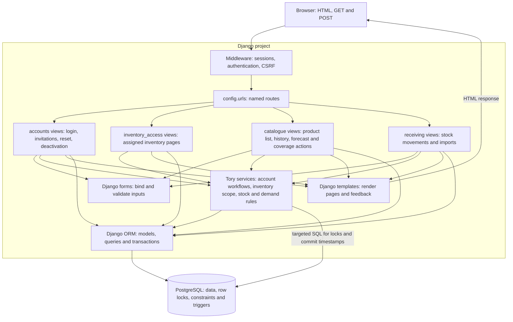
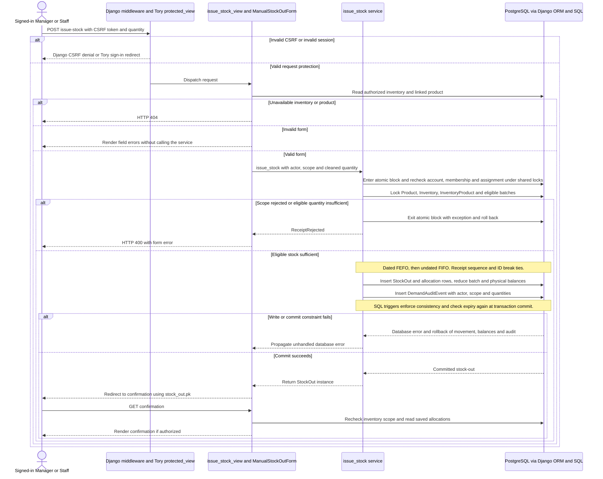

# Tory architecture and Django framework evidence

This record describes the implemented Django application after PR #55. It links implementation to FR-002 through FR-012 and NFR-003, NFR-010 and NFR-011. The SRS and dated owner decisions remain the authority for approved requirements. [SRS](../requirements/SOFTWARE_REQUIREMENTS_SPECIFICATION.md), [traceability matrix](../requirements/REQUIREMENTS_TRACEABILITY_MATRIX.md).

## Application structure

- **accounts** implements the email-based user model and the login, invitation, password reset and deactivation flows. **inventory_access** defines businesses, memberships, inventories and assignments and resolves the user's active scope. [Routes](../../config/urls.py), [account views](../../accounts/views.py), [inventory views](../../inventory_access/views.py), [inventory authorization](../../inventory_access/authorization.py).
- **catalogue** owns Product and InventoryProduct, product lifecycle and reorder settings. The Products page filters the authorized queryset and classifies rows using the existing reorder result. **receiving** owns batch movements, allocations, audit records, CSV import and demand coverage. The catalogue forecast view handles coverage actions by calling receiving demand logic and computes display results through the reorder service. [Catalogue views](../../catalogue/views.py), [receiving views](../../receiving/views.py), [reorder service](../../catalogue/reorder.py), [ERD](ERD.md).
- The middleware is configured centrally. Templates render server-side under the shared base layout. The UI design document includes proposed navigation and layout details. [Settings](../../config/settings.py), [base template](../../templates/base.html), [UI design](DESIGN.md).

## Manual stock-out

The service excludes expired batches and allocates only the non-quarantined remainder. The trigger checks protect the actual writes and the deferred expiry guard covers the commit boundary. A database error escaping the atomic block cannot produce a confirmation redirect. [Issue view and confirmation](../../receiving/views.py), [scope lock, issue service and audit write](../../receiving/services.py), [stock-out SQL guards](../../receiving/migrations/0007_stock_out_records.py), [deferred expiry guard](../../receiving/migrations/0011_expiry_quarantine_guards.py).

## Native Django features and Tory responsibilities

| Native Django feature | Exact implementation references | Tory and PostgreSQL responsibilities |
|---|---|---|
| ORM models, relationships and migrations | `InventoryProduct` declares foreign keys and model constraints. The matching catalogue migration versions schema changes. [Model](../../catalogue/models.py#L62), [initial catalogue migration](../../catalogue/migrations/0001_initial.py). | Tory defines the business relationships. PostgreSQL enforces the installed constraints and custom trigger SQL, including inventory-assignment business matching. [Assignment guard migration](../../inventory_access/migrations/0002_enforce_assignment_business_match.py). |
| Authentication and database sessions | `User(AbstractUser)` is selected through `AUTH_USER_MODEL`. `login_view` and `logout_view` use Django authentication helpers. Authentication and session middleware provide `request.user` and `request.session`. [User model](../../accounts/models.py#L36), [settings](../../config/settings.py), [account views](../../accounts/views.py). | Tory implements login throttling, absolute and idle session checks in `protected_view`, and scoped access through active memberships and assignments. [Session wrapper](../../accounts/sessions.py#L24), [inventory authorization](../../inventory_access/authorization.py#L7). |
| Forms, CSRF and template rendering | `ManualStockOutForm` validates whole-unit input. `issue_stock_view` binds POST data and consumes `cleaned_data`. The form template emits the CSRF token checked by `CsrfViewMiddleware`. [Form](../../receiving/forms.py#L40), [view](../../receiving/views.py#L142), [template](../../templates/receiving/issue_stock.html), [middleware](../../config/settings.py#L62). | Tory decides who may issue stock and whether enough eligible units are available after locks are acquired. Request integrity and input validation are separate from inventory authorization. [Stock service](../../receiving/services.py#L325). |
| Atomic transactions and row locking | `issue_stock` groups its writes with `transaction.atomic()` and uses `select_for_update()` on eligible batches. CSV import uses a wider atomic block and schedules attribution finalization with `transaction.on_commit()`. [Stock service](../../receiving/services.py#L325), [CSV service](../../receiving/csv_import.py#L115). | Tory selects the lock order and FEFO/FIFO allocation. PostgreSQL supplies the locks and enforces trigger invariants. An exception escaping the transaction causes rollback. Commit-time attribution uses PostgreSQL data. [Stock-out migration](../../receiving/migrations/0007_stock_out_records.py), [commit attribution](../../receiving/commit_times.py). |

The seven-day calculation, observation eligibility and reorder formula are Tory domain logic. Django supports querying and rendering those results. The forecast and recommendation are derived outputs. [Demand logic](../../receiving/demand.py#L122), [reorder logic](../../catalogue/reorder.py#L32).

## Verification evidence and open review

- Existing tests cover authentication and session expiry, scoped catalogue access, filter permissions, expiry and reorder status. [Authentication](../../tests/test_auth.py), [catalogue](../../tests/test_catalogue.py), [product filters](../../tests/test_inventory_product_filters.py).
- Existing stock and forecast tests exercise allocation ordering, concurrent issues, audit rollback, expiry behavior, CSV atomicity and attribution, and numeric or unavailable demand results. [Stock-out](../../tests/test_stock_out.py), [expiry](../../tests/test_expiry_quarantine.py), [CSV import](../../tests/test_csv_import.py), [demand forecast](../../tests/test_demand_forecast.py), [reorder](../../tests/test_reorder.py).
- Django PostgreSQL CI applies migrations to disposable PostgreSQL, checks Django and runs the suite. Documentation CI checks Markdown. The TORY-23 decision records both hosted workflow passes for revision `b2e4222`. [Django workflow](../../.github/workflows/django-ci.yml), [docs workflow](../../.github/workflows/docs-ci.yml), [recorded Django run](https://github.com/Mike-Franco/ay2627s2-cicdp-MikeAbat/actions/runs/42554980980), [recorded docs run](https://github.com/Mike-Franco/ay2627s2-cicdp-MikeAbat/actions/runs/42554980773).
- TORY-26's three ordinary-route p95 failures remain recorded. Hosted performance, expiry scheduling evidence, off-site recovery, and TORY-27 acceptance remain open. Full SRS approval and hosted deployment remain open. [TORY-26 measurements](../decisions/TORY-26-integrated-validation.md), [TORY-27 draft policy](../decisions/TORY-27-offsite-backup-policy.md).
- Visual review of the Mermaid diagrams in the repository renderer is pending.
