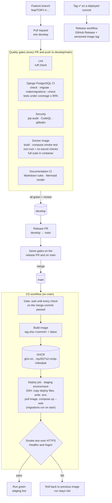

# Tory CI/CD pipeline

Every change reaches `develop` through a pull request that must pass the quality gates. A release pull request from `develop` to `main` then builds the immutable image, publishes it to GitHub Container Registry (GHCR) and deploys it to the staging VM over SSH. A smoke test against the live HTTPS URL decides whether the run is green. The CD half is defined in TORY-38 (PR #71) and becomes active once the staging VM and its secrets exist.

| Stage | Workflow | Blocks on |
| --- | --- | --- |
| Lint, tests, coverage, migrations | [Django PostgreSQL CI](../../.github/workflows/django-ci.yml) | a ruff finding, a failing test or system check, a missing migration, or coverage below 90% |
| Security | [Security](../../.github/workflows/security.yml) | a vulnerable pinned dependency, a CodeQL failure, or a secret anywhere in Git history |
| Container | [Docker image](../../.github/workflows/docker-ci.yml) | the image not building or becoming healthy, the app running as root, a secret or `.env`/`.git` in the image, or a test failing inside the container |
| Documentation | [Documentation CI](../../.github/workflows/docs-ci.yml) | a Markdown rule violation or a Mermaid diagram that does not render |
| Deploy | CD, Release (TORY-38) | any check on the merge commit failing, the stack not becoming healthy on the VM, or the HTTPS smoke test failing |

See also the [deployment view](DEPLOYMENT.md) and the [component view](COMPONENTS.md).
