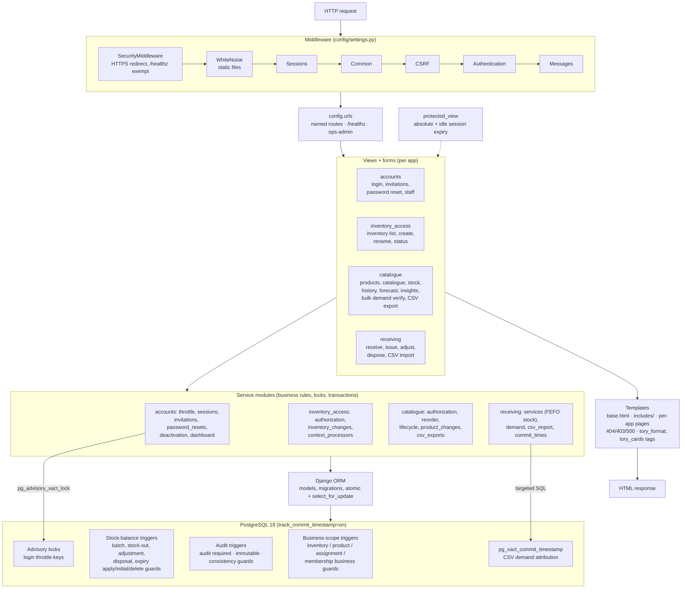

# Tory component view

Tory is one Django project with four apps. Views stay thin: they authorize, bind forms and render templates. The service modules own the business rules and take row locks. PostgreSQL triggers enforce the stock and audit invariants again at the database, so a bug or a direct SQL write cannot break them.

| Component | Key modules | Notes |
| --- | --- | --- |
| accounts | [models](../../accounts/models.py), [throttle](../../accounts/throttle.py), [sessions](../../accounts/sessions.py), [dashboard](../../accounts/dashboard.py) | Email user model. The login throttle reserves a slot under advisory locks, then hashes the password outside them (TORY-46). |
| inventory_access | [authorization](../../inventory_access/authorization.py), [inventory_changes](../../inventory_access/inventory_changes.py) | Businesses, memberships, inventories and assignments. All pages resolve scope through these helpers. |
| catalogue | [views](../../catalogue/views.py), [reorder](../../catalogue/reorder.py), [lifecycle](../../catalogue/lifecycle.py) | Products, inventory links, reorder settings and the forecast, insights and bulk verification pages. |
| receiving | [services](../../receiving/services.py), [demand](../../receiving/demand.py), [csv_import](../../receiving/csv_import.py), [commit_times](../../receiving/commit_times.py) | Batches with FEFO allocation, stock movements, expiry quarantine, disposal, audit events, CSV import and verified demand. |
| PostgreSQL triggers | migrations in each app | About 50 triggers (for example `receiving_batch_scope_balance_guard`, `receiving_audit_immutable_guard`, `inventory_access_assignment_business_guard`) re-check business scope, balances and audit immutability on every write. |

See also the [application structure and stock-out sequence](ARCHITECTURE.md), the [ERD](ERD.md), the [CI/CD pipeline](CICD_PIPELINE.md) and the [deployment view](DEPLOYMENT.md).
