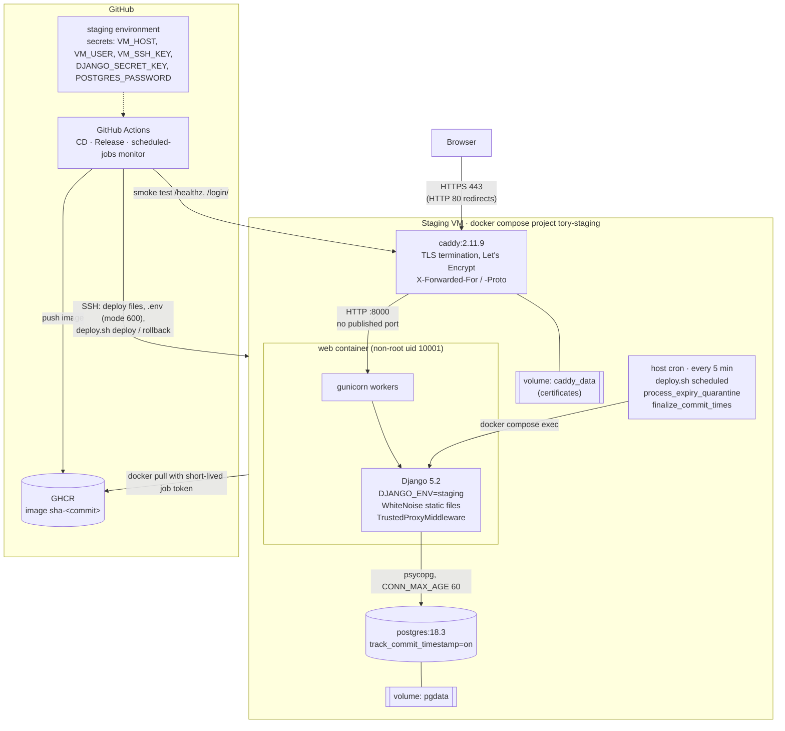

# Tory deployment view

Staging is a single Linux VM running the TORY-37 image with docker compose. Managed PostgreSQL services cannot run with `track_commit_timestamp=on`, which Tory's demand attribution requires, so PostgreSQL runs in the stack. The deployment decision and runbook are part of TORY-38 (PR #71).

| Element | Responsibility |
| --- | --- |
| Caddy | Obtains and renews the certificate for `TORY_DOMAIN`, redirects HTTP to HTTPS, and is the only container publishing ports. |
| web (gunicorn + Django) | Runs migrations on start (entrypoint) and serves the app and static files. `/healthz` checks the database. It trusts Caddy's forwarded scheme and client address only because nothing else can reach it. |
| PostgreSQL | Stores all data on the `pgdata` volume. Its triggers enforce stock and audit invariants, and commit timestamps attribute CSV demand. |
| Host cron | Runs the idempotent TORY-19 jobs every five minutes and records a heartbeat. An hourly GitHub workflow fails if the heartbeat is older than 15 minutes. |
| GitHub Actions + GHCR | Build and store immutable images. Deploy over SSH and roll back to the previous image if the smoke test fails. |

For local development the same image runs from the root [docker-compose.yml](../../docker-compose.yml): PostgreSQL plus the web container, without Caddy. See also the [CI/CD pipeline](CICD_PIPELINE.md) and the [component view](COMPONENTS.md).
