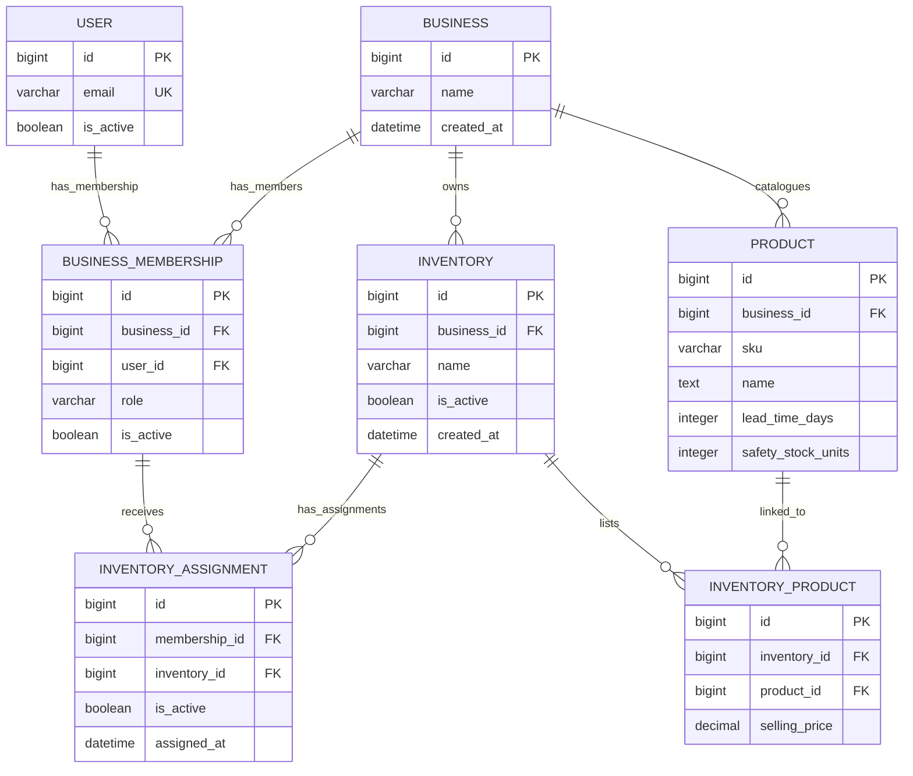

# Tory Authorization and Catalogue ERD

**Scope:** Implemented TORY-10, TORY-12 and TORY-13 structures only. This is not the complete Tory product schema or approval of unresolved G-12/G-13/G-16 policy.

## Implemented entities

The diagram matches [accounts.User](../../accounts/models.py), [inventory access models](../../inventory_access/models.py), [catalogue models](../../catalogue/models.py), and migrations [inventory access 0001](../../inventory_access/migrations/0001_initial.py), [inventory access 0002](../../inventory_access/migrations/0002_enforce_assignment_business_match.py), [catalogue 0001](../../catalogue/migrations/0001_initial.py), [catalogue 0002](../../catalogue/migrations/0002_preserve_sku_and_scope_inventory_products.py). `USER` is the existing TORY-10 model. All remaining entities are implemented in TORY-12/TORY-13.

## Keys, cardinalities and integrity

- Membership references exactly one User and one Business; `(business_id, user_id)` is unique. A user may have multiple business memberships structurally; this is not owner approval of cross-business membership policy (G-13).
- Inventory references exactly one Business. Product is shared at the Business catalogue level (BR-016). Each Product references one Business.
- InventoryProduct links exactly one Inventory and one Product; `(inventory_id, product_id)` is unique. It is the per-inventory catalogue association; an association can exist only when the inventory and product belong to the same business.
- `User.email` remains unique case-insensitively. PostgreSQL also enforces one business-scoped SKU using the unique expression `(business_id, lower(trim(sku)))`.
- PostgreSQL triggers trim outer SKU whitespace at insert, reject blank SKUs, prevent SKU or owning-business changes, and reject Product deletion. This preserves an assigned SKU on its original Product. There is no product deactivation flag or deactivation workflow in TORY-13.
- PostgreSQL triggers check inventory/product business equality on InventoryProduct insert/update and prevent changing the business of a linked Product or Inventory. The trigger locks Inventory then Product parent rows before checking so ordinary concurrent links and parent scope changes serialize around the same-business invariant. Django model validation is an additional early check; raw SQL and bulk ORM writes are covered by the triggers.
- BusinessMembership role values are Django choices `manager` and `staff`, not a PostgreSQL enum/check. Django `User.is_staff` remains the separate admin flag.
- Existing unique constraints remain: one membership per `(business_id,user_id)` and one inventory assignment per `(membership_id,inventory_id)`.

Authorization queries in [inventory access authorization](../../inventory_access/authorization.py) establish the allowed inventory scope. [Catalogue authorization](../../catalogue/authorization.py) limits catalogue rows to InventoryProduct links under those inventories. Each catalogue view also uses TORY-10 `protected_view`. A Manager role alone does not grant access to all inventories or all business catalogue data.

## Settings and provisional storage

- `lead_time_days` and `safety_stock_units` are on Product, reflecting the approved **per-product** scope in BR-010/BR-015 and the shared business catalogue. Lead time is either unset or a positive whole calendar-day count; safety stock is either unset or a nonnegative whole base-unit count. No maximum is encoded. This is a scope mapping from approved wording, not a new permission or product rule; if the owner interprets these settings as inventory-specific, the data model must change before settings workflows.
- `selling_price` is on InventoryProduct, preserving BR-018's inventory-specific price distinction. `DecimalField(18,4)` is a **provisional, unapproved storage choice only**. Currency, display scale, precision, range and maintenance permission remain unresolved. The view does not display or edit it as a currency.
- SKU `CharField(64)` is also a **provisional, unapproved storage bound** because SKU length is open under G-16. The SKU is immutable in this increment to preserve BR-038; rename/alias behavior is deferred pending owner decision. No product create/edit UI is exposed while catalogue authority remains open under G-13.

## Read-only views and boundaries

The read-only `/catalogue/` page shows only products linked to inventories the signed-in user may access. `/inventories/<id>/products/` first resolves that inventory through TORY-12 authorization, then lists its linked Products. Neither route displays unlinked business-wide products or price values. No Manager create/edit/deactivate control or Staff write action is added.

Initial Manager provisioning, assignment add/remove lifecycle and effective timing, Staff reactivation and catalogue-wide Manager authority remain unresolved under G-13. SKU character set/length and alias policy remain G-16 questions. Settings maxima, price currency/precision/validation and maintenance workflow remain unresolved. G-12/G-13 decisions must be settled before product mutation or deactivation workflows; BR-040 still requires an atomic all-business physical-stock-zero check before any future deactivation.

## Future entities (not implemented)

Receiving batches, stock movements and audit records, CSV import records, demand observation coverage, forecasts and reorder results remain future work. TORY-13 adds no stock quantity, batch, history, CSV, expiry or forecast tables.
