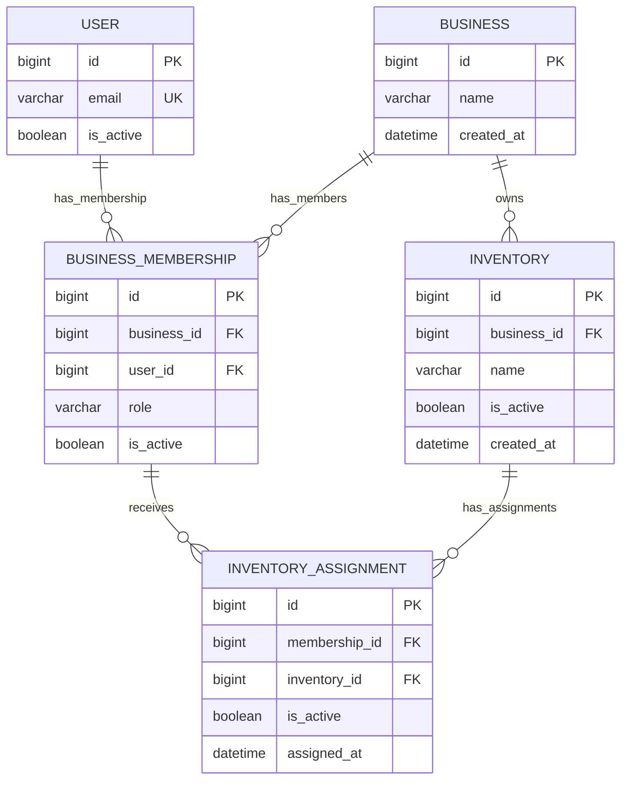

# Tory Authorization Foundation ERD

**Scope:** TORY-12 authorization foundation as implemented in Django models and PostgreSQL migrations. This is not the complete Tory product schema or approval of unresolved G-13 policy.

## Implemented entities

The diagram reflects [accounts.User](../../accounts/models.py), [TORY-12 models](../../inventory_access/models.py), and migrations [0001](../../inventory_access/migrations/0001_initial.py) and [0002](../../inventory_access/migrations/0002_enforce_assignment_business_match.py). `USER` is the existing TORY-10 Django custom email user. The remaining entities are the implemented TORY-12 authorization foundation.

## Keys, cardinalities and integrity

- Each membership references exactly one User and one Business. A user may have multiple business memberships structurally; this schema capability is **not** owner approval of cross-business membership policy (G-13).
- Each Inventory belongs to exactly one Business. A Business may have many inventories and memberships.
- Each InventoryAssignment links exactly one BusinessMembership to one Inventory. It is the explicit grant for viewing that inventory; membership role alone grants no inventory access.
- `User.email` is unique and case-insensitive through the model's unique field plus PostgreSQL `UNIQUE (lower(email))` constraint.
- Database unique constraints enforce one membership per `(business_id, user_id)` and one assignment per `(membership_id, inventory_id)`.
- `BusinessMembership.role` uses Django choices `manager` or `staff`; Django choices are application validation, not a PostgreSQL enum/check constraint. Django `User.is_staff` is the unrelated Django admin flag and is not the Tory Staff role.
- The membership/inventory same-business invariant spans foreign keys, so an ordinary row `CHECK` cannot enforce it. `InventoryAssignment.clean()` and `save()` validate ORM writes. Migration 0002 also installs PostgreSQL triggers that reject cross-business assignment inserts/updates, and prevent moving an assigned membership or inventory to a different business. The assignment trigger takes row locks on both parent scope rows before checking, so concurrent assignment writes and parent business changes serialize around the invariant.
- PostgreSQL tests cover model validation, raw SQL insertion of an invalid cross-business assignment, and attempted business movement with assignments in place. The trigger protects SQL and bulk ORM writes that bypass model validation.

Authorization queries in [authorization.py](../../inventory_access/authorization.py) filter on the authenticated active user, active membership, active assignment, same business and active inventory before returning rows. The inventory detail view scopes by that query before looking up the requested ID, yielding 404 for an unassigned or foreign inventory. Every inventory page uses TORY-10 `protected_view` for its session expiry checks.

## Assignment and role meaning

A BusinessMembership answers **which business role the user holds**. An InventoryAssignment answers **which specific inventory that member can access**. A Manager role does not imply access to every business inventory. The TORY-12 assignment service additionally permits a Manager to assign Staff only to an inventory for which that Manager already has an active assignment in the same business (BR-027).

The database triggers enforce referential scope consistency, not Manager authority or assignment lifecycle. Manager assignment authority is checked in the application service; provisioning, adding/removing assignments, when a change takes effect, cross-business membership policy, Staff reactivation and catalogue-level Manager authority remain unresolved under G-13. Concurrent assignment-change semantics remain a G-11 Design dependency. No assignment management UI or initial Manager setup is implemented.

## Future tables (not implemented here)

The diagram intentionally excludes the shared business-level Product catalogue (BR-016), inventory-specific product settings, receiving batches, stock movements/audit records, CSV imports, demand-observation coverage, forecasts and reorder records. Add those entities in later increments after their approved requirements and design dependencies are satisfied; no inventory or product behavior is implied by this ERD.
