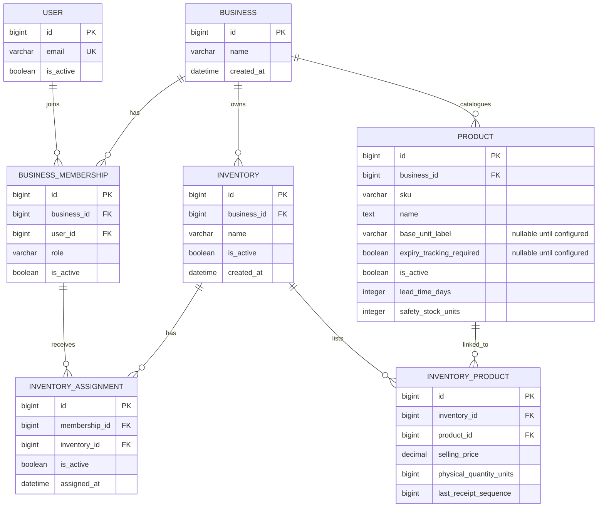
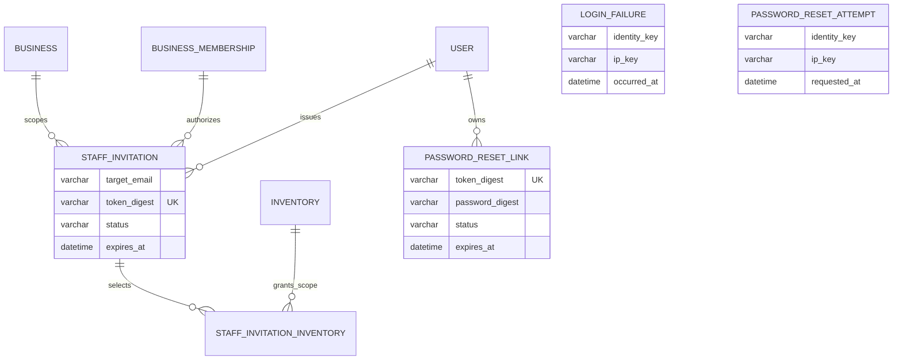
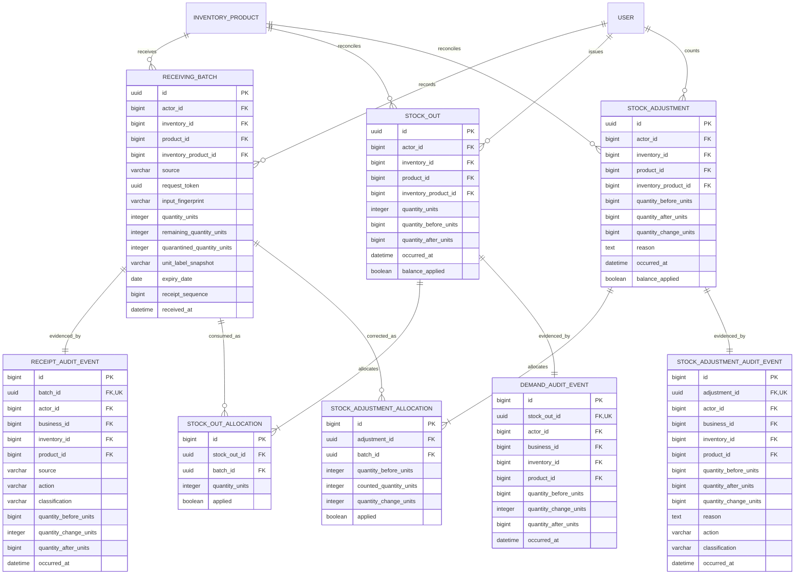
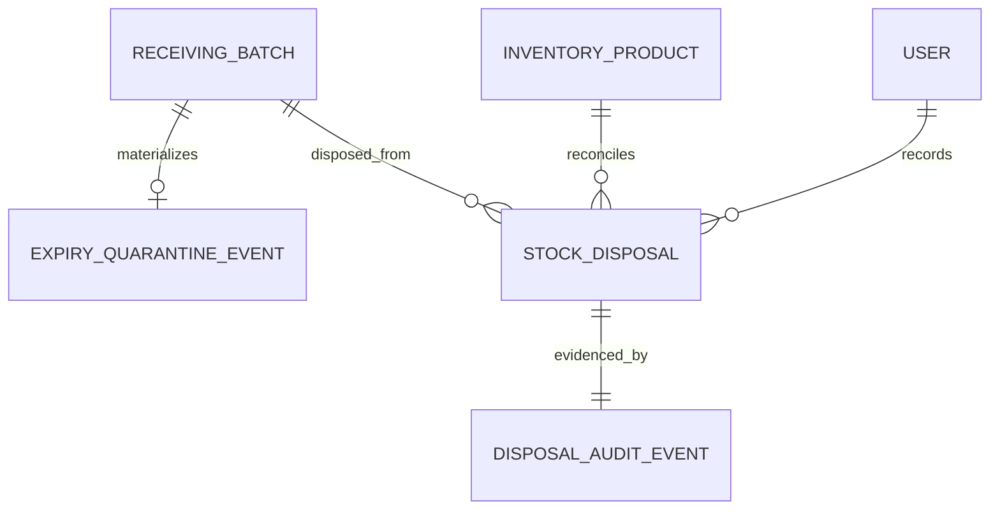
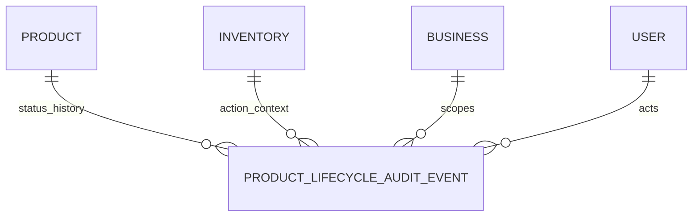
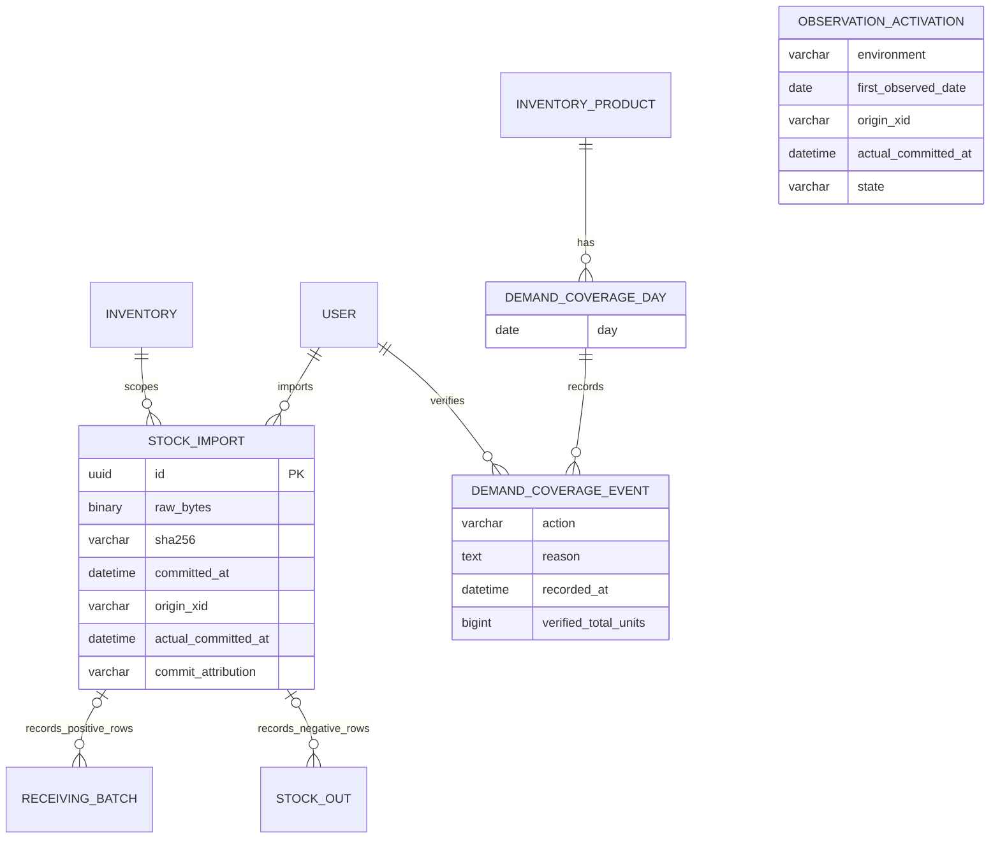
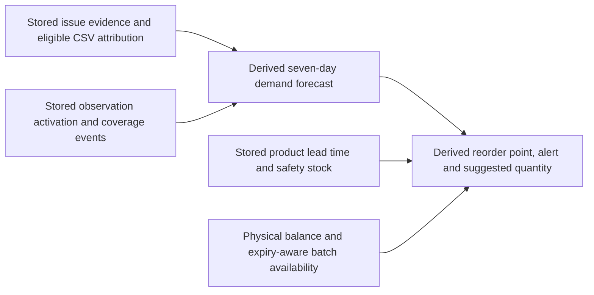

# Tory implemented data model

This ERD describes the repository after PR #55. Each diagram shows a subset of the same PostgreSQL schema. Entity names correspond to Django model classes. Selected fields and relationships explain domain ownership and movement history. Repeated entity names refer to the same table.

## Accounts, inventory scope and catalogue

Membership gives a Manager or Staff role in one business. Active inventory assignments determine the locations the member can access. The inventory/product link stores the physical balance and last receipt sequence. [Accounts models](../../accounts/models.py), [inventory access models](../../inventory_access/models.py), [catalogue models](../../catalogue/models.py).

## Account invitations, resets and throttling

Login failures and reset attempts store hashed throttle keys without a User foreign key. The invitation target is an email until redemption creates the Staff account, membership and assignments. Staff deactivation updates existing account and access state while preserving referenced history. Django sessions use the framework's database session backend and store serialized session data without a User foreign key. [Account models](../../accounts/models.py), [invitation service](../../accounts/invitations.py), [deactivation service](../../accounts/deactivation.py), [session settings](../../config/settings.py).

## Receipts, issues and count adjustments

Cardinalities describe complete committed movements. Allocation rows identify the affected batches. Movement and audit models also carry explicit actor and scope foreign keys where shown in their fields. Receipt and adjustment audit represent non-demand activity. DemandAuditEvent ties issued quantities to the StockOut and its actor and scope. The approved count rules are recorded in the [TORY-18 decision](../decisions/TORY-18-manager-batch-count-rules.md). [Receiving models](../../receiving/models.py).

## Expiry and disposal

An expiry transition can be absent while expiry-aware reads already exclude expired units from available stock. Disposal writes a separate non-demand audit with Manager attribution. [Receiving models](../../receiving/models.py).

## Product lifecycle

Product lifecycle evidence records shared Product activation changes and the inventory from which the action was taken. [Catalogue models](../../catalogue/models.py), [lifecycle rules](../decisions/TORY-14-product-deactivation.md).

## CSV imports and demand coverage

Successful CSV imports store the original bytes and digest. Same-inventory duplicate detection checks byte equality on digest matches. Each imported movement refers back to the import and its row number. Manual movements leave the import FK empty. The legacy completion timestamp and finalized actual commit timestamp have different meanings. Observation activation is an environment-wide boundary with no coverage-day foreign key. Coverage is keyed by inventory/product and Singapore date. Append-only events capture Manager verification or incompleteness. [CSV service](../../receiving/csv_import.py), [commit-time attribution](../../receiving/commit_times.py), [receiving models](../../receiving/models.py).

## Derived forecast and reorder outputs

The forecast uses the previous seven complete Singapore days when coverage and demand attribution allow a numeric result. The recommendation uses the full-precision forecast and expiry-aware available stock. These are computed service results rendered by the catalogue view. The schema stores their inputs and evidence. [Forecast implementation](../../receiving/demand.py), [recommendation implementation](../../catalogue/reorder.py), [forecast view](../../catalogue/views.py).

## Keys, constraints and integrity

- Existing `(business_id,user_id)` membership and `(membership_id,inventory_id)` assignment uniqueness, user email uniqueness, business-scoped case-insensitive SKU uniqueness and `(inventory_id,product_id)` link uniqueness are unchanged.
- New InventoryProduct links must begin with both physical balance and last receipt sequence equal to zero; a PostgreSQL INSERT trigger covers model saves, bulk ORM writes and raw SQL. Existing rows are preserved. Receipt-batch insertion later advances both counters atomically. InventoryProduct stores the physical product/inventory balance (including quarantined units) and last committed receipt sequence; database checks cap the balance at 2,147,483,647. Direct ORM/SQL changes to those counters are rejected.
- InventoryProduct parent identity cannot be reassigned. Its association can only be deleted while it has neither physical units nor receipt history; foreign keys and a trigger retain links referenced by a batch.
- Product requires an explicit nonblank base-unit label and non-null `expiry_tracking_required` before receipt. TORY-16 migrated legacy products as active with both receiving settings unset. A receiving batch snapshots the unit label so later presentation does not alter receipt evidence.
- ReceivingBatch has a stable UUID identity, source, actor, operation-scoped request token, canonical-input SHA-256 fingerprint, whole-unit quantity, expiry, timestamp and sequence. PostgreSQL enforces token uniqueness per `(actor,source,request_token)`, unique `(inventory_product,receipt_sequence)`, positive bounded quantity, and remaining/quarantine bounds. The insert trigger checks active account/membership/assignment/inventory/product, same-business linked association, expiry policy and the aggregate balance; it advances the balance and sequence in the same transaction.
- ReceiptAuditEvent is one-to-one with a batch. Its database trigger verifies scope, actor, source, batch quantity, non-demand classification and the after-balance against the InventoryProduct aggregate. Checks bound the before/change/after quantities. A deferred constraint trigger rejects commit unless every inserted batch has its event. Update/delete triggers and protected foreign keys prevent erasing or rewriting committed receipt identity and attribution.
- The request token and batch are one row: validation or audit failure rolls the token back with the batch, balance and sequence. A replay first rechecks current authorization and matching product/link state. A committed replay compares the canonical input fingerprint before checking the current date, so an original receipt remains replayable after its expiry date passes.

## Lock protocol and authorization

Receipt transactions lock active User, BusinessMembership and InventoryAssignment rows `FOR SHARE`, then Product, Inventory and InventoryProduct `FOR UPDATE`, in that order. Shared authorization locks allow independent receipts to proceed while conflicting account/membership/assignment revocation waits. If revocation commits first, the subsequent locked read rejects; if the receipt obtains the authorization locks first, revocation waits until receipt commit. Product is the cross-inventory serialization anchor; Inventory follows Product to align with the InventoryProduct trigger. Django prevalidates an expiry date after acquiring locks using its Asia/Singapore local date; PostgreSQL independently checks `clock_timestamp()` in the batch INSERT trigger. If the database boundary rejects after the application check passed, only its stable `receiving_expiry_after_singapore_today` constraint is translated to a field error after transaction rollback. These are distinct clock reads; synchronized clocks remain an operational assumption. Token replay is resolved before new-receipt expiry validation.

TORY-13's former Inventory→Product trigger order was replaced in the reversible `catalogue/0004` migration with Product→Inventory. The receiving insert trigger follows the same parent order. Since an UPDATE locks InventoryProduct before its BEFORE trigger, `receiving/0004` rejects association identity changes instead of risking a link-row→parent-lock cycle against Product→Inventory→link receipt writers. InventoryProduct row locking and its database trigger serialize aggregate updates and sequence allocation. The Product lock serializes same-product receipts across inventories; the association row protects each per-inventory aggregate. Both are held through audit commit/rollback.

These locks are shared by receiving, stock-out and count-adjustment writes. Stock-out and adjustment lock affected batches in stable order after locking Product, Inventory and InventoryProduct. Adjustments recheck Manager assignment and batch eligibility under those locks; their database operation and per-batch markers are one-time and must reconcile to the aggregate delta. Deadlocks and serialization failures are not silently retried; a new attempt must pass current authorization and validation again.

Authorization remains server-side. `receiving.services._lock_authorized_scope` rechecks active account, same-business active membership, explicit active assignment, active inventory/product and linked InventoryProduct inside the transaction. Protected views also use TORY-10 `protected_view`; forms are POST + CSRF; form IDs are never treated as authority. Manager role alone grants no inventory-wide or cross-business access.

## Expiry integrity and open boundaries

TORY-19 adds a one-to-one ExpiryQuarantineEvent for each expired ReceivingBatch. It stores explicit system attribution, business/inventory/product, effective Singapore-midnight timestamp, PostgreSQL-recorded timestamp, and residual physical/available/quarantine quantities. PostgreSQL checks expiry scope and quantity reconciliation, requires the batch's stored quarantine state to commit with the event, and prevents event edits/deletion. Available-to-issue and displayed quarantine are derived from expiry at read time even before this event exists. The retryable command uses the existing Product → Inventory → InventoryProduct → Batch lock order. A deferred allocation guard rechecks expiry at commit, including transactions that cross midnight. See [TORY-19 implementation note](../decisions/TORY-19-expiry-quarantine.md).

TORY-19 also adds StockDisposal and a one-to-one DisposalAuditEvent. An assigned Manager's expired-batch disposal deducts remaining batch units and physical balance, plus stored quarantine when the transition was recorded. PostgreSQL links both deductions to the one-time disposal marker and requires the non-demand audit at commit. The audit retains Manager, scope, batch, quantities, approved reason code and note. If disposal precedes expiry evidence, the later system event reconciles disposed units and residual stock. The Damaged reason code applies only to quarantined units; nonquarantined damaged goods remain outside this operation.

- `base_unit_label` is stored in a 40-character field and validated as nonblank; 40 is a technical storage limit, not a separately approved label-length rule. Packaging conversion remains deferred.
- InventoryProduct's physical balance is initialized to zero on migration. There were no prior stock quantities in TORY-13 to migrate; no historical balance is fabricated.
- The operator-only `configure_receiving` command initializes a product's label and expiry policy before first receipt. There is no catalogue configuration UI or new Manager catalogue authority.
- `remaining_quantity_units` begins equal to receipt quantity and `quarantined_quantity_units` begins at zero. TORY-17 stock-out may decrement remaining eligible units; TORY-18 may set remaining units to an absolute count up to the physical-unit cap on existing eligible batches. Both operations preserve receipt identity, sequence and expiry and carry one-time database-bound operation/allocation evidence. Count adjustments reject expired and quarantined batches; they neither create batches nor implement BR-037 disposal.
- The original TORY-16 receipt trigger accepted manual receipts only. TORY-22 added CSV receipt guards and shares the same per-link ordering. See the [CSV guard migration](../../receiving/migrations/0015_csv_receipt_guards.py).
- G-02 one-hour scheduler/staging verification, G-05 damaged/returned-stock disposition, G-09 rejected-attempt logging, G-11 broader concurrency, G-13 lifecycle/authority and G-10 hosting feasibility remain open as recorded. Receipt, demand, adjustment, expiry-transition and Manager disposal audit records are implemented.

See the [structural architecture and stock-out sequence](ARCHITECTURE.md) for Django framework evidence, linked tests and verification limits.
